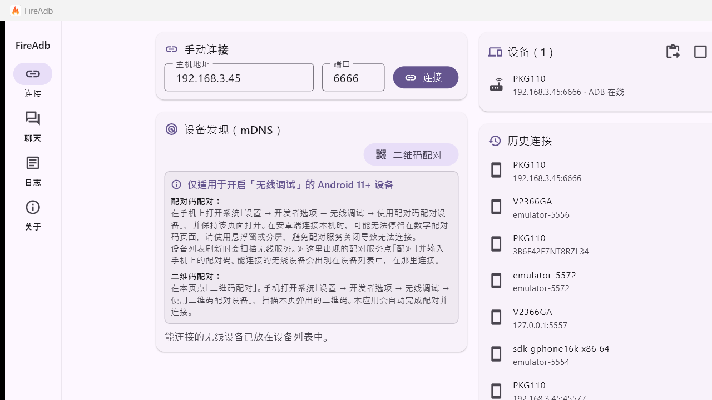
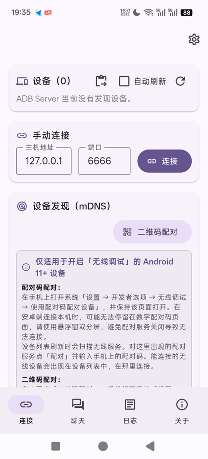
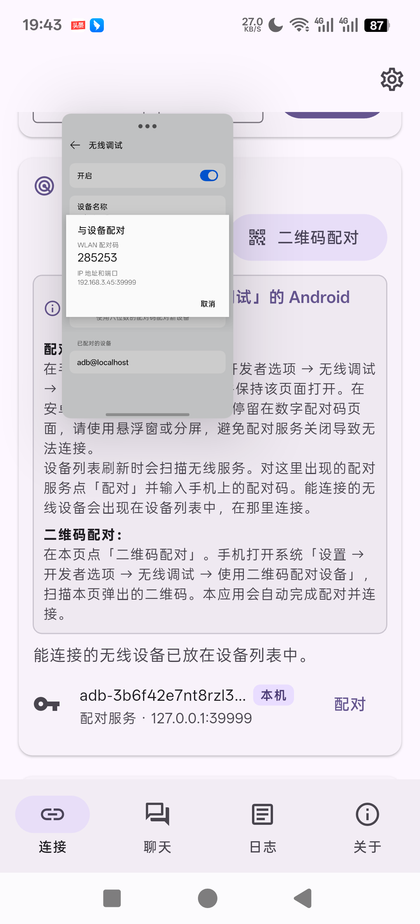

[中文](README.md) | English

# FireAdb

A cross-platform ADB toolbox. The computer and the phone share the same interface. After a device is connected, you can view its details, manage apps and files, take screenshots and screen recordings, run commands, chat between devices, and copy the clipboard both ways.

Windows, Linux, macOS, and Android.

## Interface

The connection page on a computer. Enter an address to connect directly, or use a pairing code or a QR code for wireless debugging. Devices that are already listed appear on the right.

The phone starts on the same connection page. The bottom bar switches to chat, logs, and about.

## What you can do

**Connect a device**

- USB devices, emulators, and wireless devices appear in one list, which can refresh automatically
- Wireless debugging is described at the end
- Enter a host and port by hand. Addresses you have used stay in the history

**After connecting**

- Device overview: model, brand, and OS version
- Apps: view installed apps, export APKs, uninstall, or freeze
- Files: browse the device, upload, download, edit, rename, and change permissions
- Screenshots and screen recordings, saved on this machine
- Command panel: run shell commands and read the output
- Clipboard: copy between this machine and the device

**Chat**

- A direct chat, or a new channel that other devices can join
- Send text, images, and files

## Wireless debugging

On Android 11 or later, open Settings → Developer options → Wireless debugging. The phone and FireAdb need to be on the same Wi-Fi.

The first time you pair, keep the system pairing-code page in front, in split screen or a floating window, and scan from FireAdb. Leaving that page turns the pairing service off.

1. In Developer options, turn on Wireless debugging, open Pair device with pairing code, and stay on the page that shows the code.
2. Put that page in a system floating window.
3. In FireAdb, tap Auto scan. The row with a key is the pairing service. Tap Pair and enter the code shown on the phone.
4. After pairing succeeds, the device shows up in the device list. Tap it to connect.

A device that has already been paired can be connected from the device list. You do not need to open the pairing-code page again.

QR code pairing on the same page is another path. On the phone, open Pair device with QR code and scan the code FireAdb shows. Pairing and connecting then finish on their own. A phone connecting to itself usually cannot scan the QR code shown by FireAdb on that same phone, unless it has an external camera. This path is mainly for showing a QR code so another Android device can finish the ADB connection and be managed from here.
