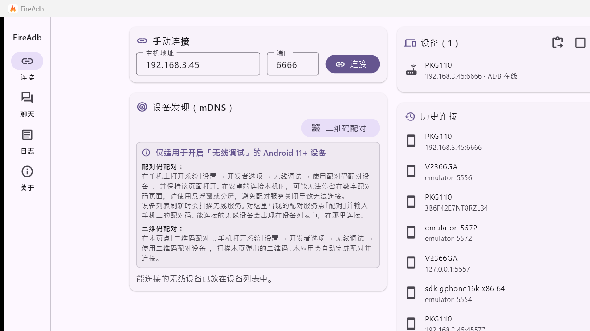
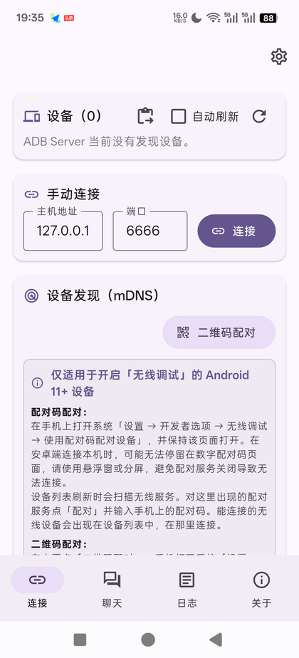
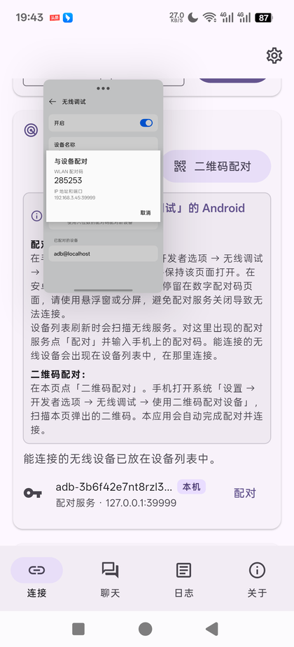

中文 | [English](README.en.md)

# FireAdb

跨平台 ADB 工具箱。电脑和手机使用同一套界面：连上设备后，可以查看设备信息、管理应用和文件、截图录屏、执行命令，也可以在设备之间聊天、互传剪贴板。

支持 Windows、Linux、macOS 和 Android。

## 界面

电脑端的连接页。可以填写地址直接连接，也可以用配对码或二维码做无线调试，已出现的设备会列在右侧。

手机端同样从连接页开始，底部可以切到聊天、日志和关于。

## 能做的事

**连接设备**

- USB、模拟器和无线设备出现在同一个列表里，可以自动刷新
- 无线调试的配对接法见文末
- 手动填写主机地址和端口；连过的地址留在历史里

**连上之后**

- 设备总览：型号、品牌、系统版本
- 应用：查看已安装应用，导出 APK，卸载或冻结
- 文件：浏览设备上的文件，上传、下载、编辑、改名和改权限
- 截图和录屏，结果保存在本机
- 命令面板：执行 shell 命令并查看输出
- 剪贴板：本机和设备互相复制

**聊天**

- 私聊，或新建频道把其他设备加进来
- 可以发送文字、图片和文件

## 无线调试

Android 11 及以上，打开「设置 → 开发者选项 → 无线调试」，手机和 FireAdb 在同一 Wi-Fi。

还没配对过时，把系统的配对码页面留在上面（分屏或悬浮窗），下面用 FireAdb 扫描。离开配对码页面后，系统会关掉配对服务。

1、手机系统设置的开发者选项中打开无线调试选项，打开「使用配对码配对设备」，停在显示配对码的页面。
2. 对该页面开启系统悬浮窗。
3. FireAdb 点「自动扫描」。带钥匙的一行是配对服务，点「配对」，输入页面上的配对码。
4. 配对成功后，设备列表会出现对应的可连接的设备，点击即可连接。

已经配对过的设备不用再打开配对码，可直接在设备列表中连接。

同一页的「二维码配对」是另一条路：手机用系统里的「使用二维码配对设备」扫描FireAdb生成的二维码，配对和连接会被自动完成。同一个手机连接自身，基本无法扫描到本机上的FireAdb，除非有外置摄像头，这个主要提供二维码，在其他安卓设备完成adb连接，管理其他安卓设备的。
