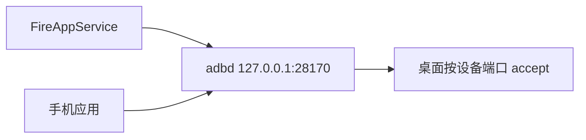

# 聊天和剪贴板通道

桌面为每台设备在本机听一个端口，并登记 `adb reverse`：手机上的 `127.0.0.1:28170` 交回这个端口。FireAppService 和手机应用都作为客户端来连。`exec` 只负责把 FireAppService 拉起来并托住进程。

连上后的第一条必须是 `session.hello`。token 对不上就关掉。

| 字段 | 作用 |
|---|---|
| `role` | `service` 或 `app`。同一设备同一角色的新连接替换旧的 |
| `token` | 桌面生成，放进服务的启动参数。服务写到本应用外部目录 `fireadb-link`，应用从那里读取 |
| `selfId` | 只有应用带上，用来对上聊天客户端 |

剪贴板走 `service` 那条连接。聊天走 `app` 那条。应用被冻结只断 `app`。

直连 adb 时，设备发来的 `OPEN tcp:端口` 由 `AdbConnection.onPeerOpen` 接住，再交到对应的本机端口。经本机 adb server 时，由 server 自己完成这一跳。
