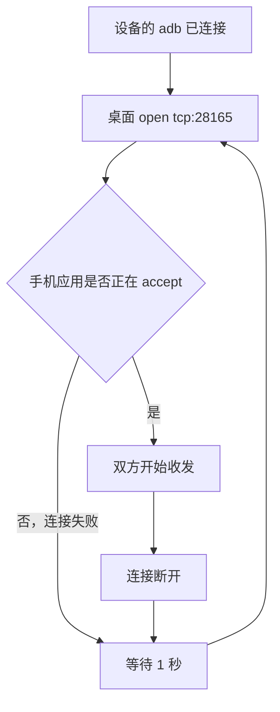

# 聊天通道

手机应用监听 `127.0.0.1:28165`。桌面调用 `AdbConnection.open('tcp:28165')`，adbd 去连这个端口。`open` 成功才表示手机应用正在 `accept`，可以收发。adb 已经连上设备，不代表这次 `open` 会成功。



## 没人听的时候

`ChatPipe._loop` 在设备连上后一直循环。`open` 失败就把这次连接丢掉，1 秒后再试。失败期间 `_shell` 是空的，桌面发消息会直接得到「聊天通道还没接上」。

```dart
while (!_closed) {
  try {
    _shell = await device.openService('tcp:28165');
    await _read(_shell);
  } catch (_) {}
  _shell = null;
  await Future.delayed(const Duration(seconds: 1));
}
```

手机侧同样以「有没有已经 `accept` 的连接」为准。没有就拒绝发送：

```kotlin
fun send(bytes: ByteArray): Boolean {
  val dest = output ?: return false
  dest.write(bytes)
  return true
}
```

这时打开别人的会话，拉取失败，界面仍显示本机已经有的记录。

## 听上之后

手机 `accept` 返回，记下这条连接，并通知 Dart。Dart 发出 `chat.ready`。桌面收到后，才沿着这条已经接上的流拉取消息。

```kotlin
val client = server.accept()
output = client.outputStream
onLinked()
```

```dart
onLinked: () => _announceSelf() // 发送 chat.ready
```

连接中途断开时，手机清掉 `output`，桌面清掉 `_shell`，循环回到上面的等待。
