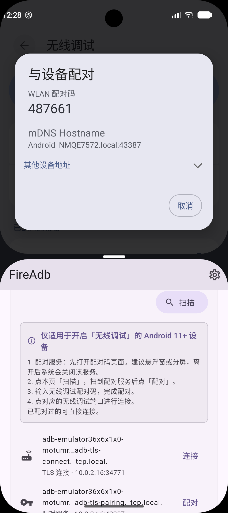

# 无线调试：mDNS 扫描与配对

适用于 Android 11 及以上、已打开「设置 → 开发者选项 → 无线调试」的设备。手机和 FireAdb 在同一 Wi-Fi。

还没配对过时，按下面四步做。已经配对过的设备不必再配对，直接连接 TLS 端口。

分屏时，上面留着系统的配对码页面，下面用 FireAdb 扫描和输入。离开配对码页面后，系统会关掉配对服务，扫描结果里的「配对」会消失。

## 扫描结果

点首页「设备发现（mDNS）」里的「扫描」。无线调试会出两类服务：

| 列表副标题 | 服务类型 | 按钮 | 何时出现 |
|---|---|---|---|
| 配对服务 | `_adb-tls-pairing._tcp` | 配对 | 只在配对码页面开着时 |
| TLS 连接 | `_adb-tls-connect._tcp` | 连接 | 无线调试开着就有 |

截图里系统页面是「与设备配对」。上面的 WLAN 配对码填进 FireAdb；mDNS 主机名后面的端口是配对端口。下面 FireAdb 里带钥匙图标的一行是配对服务，带「连接」的一行是 TLS 端口。这两个端口不是同一个。

`adb tcpip` 打开的固定端口是另一项「ADB 传输」（`_adb._tcp`），直接点「连接」，不用配对码。

## 还没配对过

1. **配对服务。** 在手机上打开无线调试里的「使用配对码配对设备」，停在显示 WLAN 配对码的页面。建议用悬浮窗或分屏，离开后系统会关闭该服务。
2. **扫描。** 点 FireAdb 本页的「扫描」。扫到配对服务后，点这一行的「配对」。
3. **输入配对码。** 在「无线配对」弹窗里输入页面上的配对码，点「配对」。
4. **连接。** 配对成功后，点同一台设备上「TLS 连接」那一行的「连接」。

## 已经配对过

不用打开配对码页面，也不用点「配对」。扫描后直接点「TLS 连接」那一行的「连接」。
